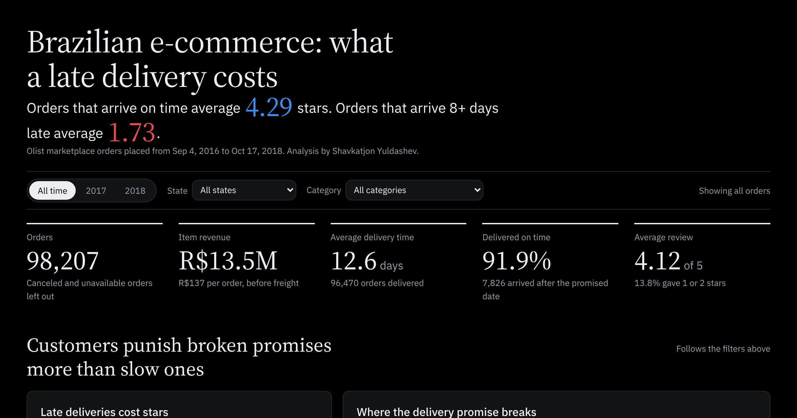

# Brazilian E-Commerce: SQL-First Business Analysis

Analyzing ~99,000 orders from the Olist Brazilian E-Commerce dataset to answer
five operational questions — using SQL for extraction and Python for
visualization and interpretation. No machine learning: the goal is to turn raw
transaction data into decisions a business could act on.

**Headline findings:**
- Only **3.12%** of customers ever order again — the marketplace is structurally one-time-purchase.
- **Late delivery is the dominant driver of poor reviews**: on-time orders average 4.29 stars, orders 8+ days late average 1.73 — a 60% collapse.
- Customers punish **broken delivery promises more than slow ones**: across states, the average review tracks the on-time rate (r = 0.78) more closely than delivery days (r = −0.53).

---

## Live Dashboard

**[Open the interactive dashboard](https://shavkatjony.github.io/brazilian-e-market/)**. Filter by
year, state and category, or click a state on the map to filter every chart. Filtered views have their own
links, so you can share exactly what you are looking at.

[](https://shavkatjony.github.io/brazilian-e-market/)

The site is plain HTML and d3, served free by GitHub Pages from [`docs/`](docs/). Every number is rebuilt
from the raw Kaggle files by [`src/build_web_data.py`](src/build_web_data.py).

---

## The Questions

1. **Customer retention** — how loyal is the base, and how many customers have gone quiet?
2. **Delivery vs. satisfaction** — do delivery delays actually lower review scores?
3. **Seller performance** — which sellers drive revenue, and is it concentrated or spread?
4. **Cohort retention** — do customers acquired in different months return at different rates?
5. **Logistics bottlenecks** — which regions experience the slowest deliveries?

The full narrative — question → context → SQL → chart → insight → recommendation
— lives in [`notebooks/analysis.ipynb`](notebooks/analysis.ipynb). The executive
one-pager is in [`reports/findings.md`](reports/findings.md).

---

## Key Findings

### 1. The base is one-time-purchase
70.7% of customers are already **At Risk** (41.4%) or **Churned** (29.3%);
only 10.1% are Active. At a 3.12% repeat rate, this is the normal shape of the
business, not a churn problem to fix.


### 2. Late delivery destroys reviews
Review scores fall in near-perfect step with lateness — every additional band
costs roughly a full star.


### 3. No seller dominates, but revenue follows an 80/20 pattern
The largest seller makes just 1.7% of item revenue and the top 15 make 17.6%.
Across all 3,053 sellers, 540 (17.7%) make 80% of item revenue, so seller
support should start with that top group, not the long tail.
*(Corrected: an earlier version divided item revenue by total payments, which
include freight, and reported 14.6% and 1.4%.)*


### 4. Retention is uniformly low across every cohort
Flat at 3–5% from early 2017 onward. No acquisition period produced stickier
customers, confirming the one-time pattern is structural, not seasonal. (The
100% spike is a single-customer 2016 cohort and is disregarded.)


### 5. Customers punish broken promises, not distance
The northern states are the slowest: Roraima (29.4 days), Amapá (27.2) and
Amazonas (26.4) against a 12.6-day average. Yet Amapá and Amazonas arrive on
time about 96% of the time, because their delivery estimates are long, and both
average above 4.1 stars (small samples: 68 and 147 orders). The broken promises
sit where the volume is: Rio de Janeiro (12,698 orders, 86.5% on time, 3.90
stars) and the Northeast (Alagoas 76.1%, Maranhão 80.3% on time).


---

## Recommendations

1. **Treat first-order delivery as the retention strategy.** Since customers
   rarely reorder, a late first delivery is often the customer's entire brand
   experience. Do *not* invest in loyalty programs — there is no repeat base to reward.
2. **Fix promise-keeping where the volume is**: Rio de Janeiro and the
   Northeast (AL, MA). Review carriers there and make delivery estimates
   realistic; the slow northern states mostly keep their promises already.
3. **Monitor the on-time delivery rate weekly** — it maps directly onto the
   review score the marketplace depends on.

---

## Method & Tech

An SQL-first approach mirrors real-world data extraction: raw CSVs are loaded
into a SQLite database, SQL does the heavy lifting (CTEs, window functions,
joins, aggregation), and Python (pandas, matplotlib) handles visualization and
narrative synthesis.

**Stack:** SQLite · SQL · Python · pandas · matplotlib · d3.js · GitHub Pages

**Data:** [Olist Brazilian E-Commerce Public Dataset](https://www.kaggle.com/datasets/olistbr/brazilian-ecommerce)
— ~99K orders across 9 tables, Sept 2016 – Oct 2018.
*Raw CSVs and the built `.db` are gitignored to keep the repo lightweight; both
are regenerable from the ingestion script.*

---

## Repository Structure

```text
brazilian-e-market/
├── data/
│   ├── raw/                  # 9 Kaggle CSVs (gitignored)
│   └── olist.db              # SQLite database (gitignored — rebuildable)
├── src/
│   ├── create_db.py          # builds olist.db from the CSVs
│   ├── olist_common.py       # shared definitions for the export scripts
│   ├── build_web_data.py     # builds the live dashboard's data in docs/data/
│   └── export_tableau.py     # optional: Tableau-ready CSVs in tableau/data/
├── sql/
│   ├── 00_exploration.sql    # schema + data-quality checks
│   ├── 01_at_risk_customers.sql
│   ├── 02_delivery_vs_reviews.sql
│   ├── 03_seller_performance.sql
│   ├── 04_cohort_retention.sql
│   ├── 05_logistics_bottlenecks.sql
│   └── notebook/             # single-query files feeding the notebook charts
├── notebooks/
│   └── analysis.ipynb        # the full narrative analysis
├── reports/
│   ├── findings.md           # executive summary
│   └── figures/              # exported charts (300 DPI)
├── docs/                     # the live dashboard (GitHub Pages)
│   ├── index.html
│   └── data/                 # dashboard data (rebuildable)
├── requirements.txt
├── .gitignore
└── README.md
```

---

## Reproduce It

```bash
# 1. clone and enter
git clone https://github.com/shavkatjony/brazilian-e-market.git
cd brazilian-e-market

# 2. install dependencies
pip install -r requirements.txt

# 3. download the dataset from Kaggle (https://www.kaggle.com/datasets/olistbr/brazilian-ecommerce) into data/raw/

# 4. build the database from the CSVs
python src/create_db.py

# 5. open the analysis
jupyter lab notebooks/analysis.ipynb

# 6. rebuild the dashboard data and preview the site at http://localhost:8000
python src/build_web_data.py
cd docs && python -m http.server 8000
```

---

## Notes & Limitations

- Revenue uses `order_items.price` (item value), not payment totals, to avoid
  double-counting orders shared across sellers.
- Delivery metrics cover only completed deliveries with valid dates.
- Customers are identified by `customer_unique_id`, not the per-order `customer_id`.
- The data ends in Oct 2018; review scores are self-selected; acquisition cost
  is unknown — so "retention is low" is a strong signal, not a full ROI case.

---

*Analysis by Shavkatjon Yuldashev.*
*email: shavkatjon.yuldashev.0411@gmail.com*