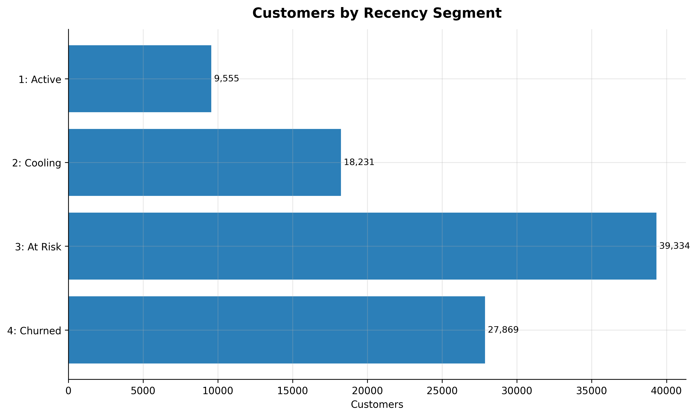
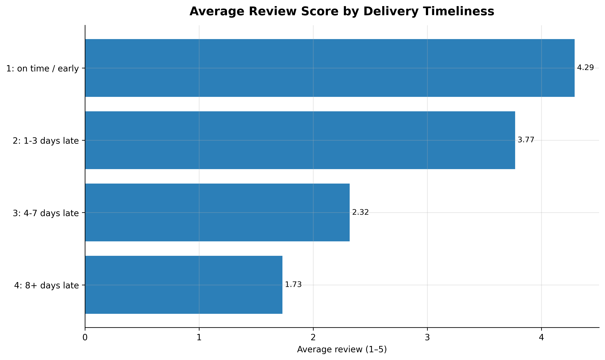
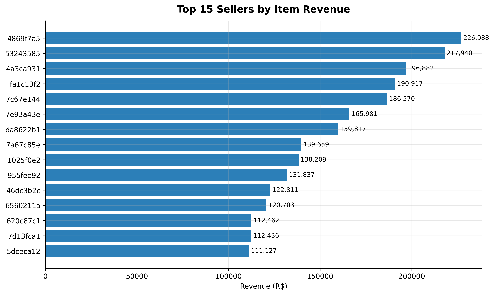
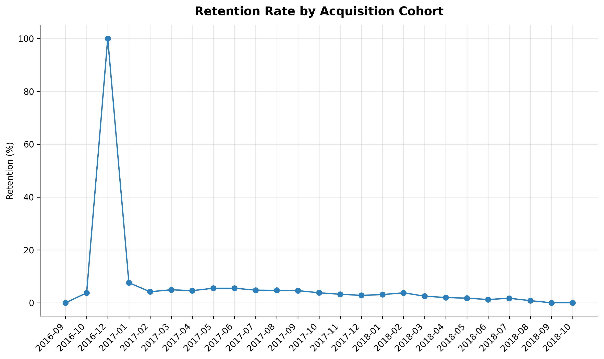
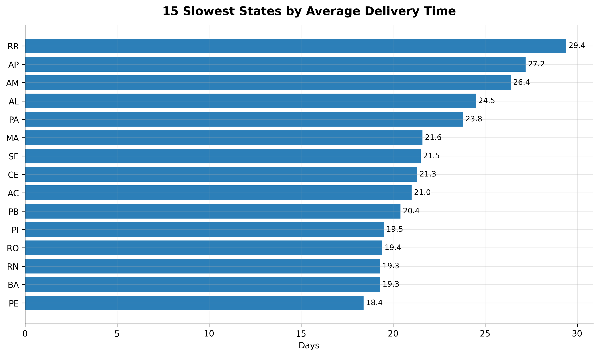

# Brazilian E-Commerce: Business Findings & Recommendations

**Analyst:** Shavkatjon Yuldashev
**Data:** Olist Brazilian E-Commerce Public Dataset (Sept 2016 – Oct 2018, ~99K orders)
**Method:** SQL extraction (SQLite) + Python analysis (pandas, matplotlib). Full workflow in `notebooks/analysis.ipynb`; queries in `sql/`.

---

## Executive Summary

Across **96,096 customers** and **99,441 orders** (R$ 16.0M in payments), two
patterns dominate and point to the same conclusion. First, the marketplace is
almost entirely one-time purchase: only **3.12%** of customers ever order
again. Second, delivery is slow (**12.6 days** on average) and its timeliness
is the single clearest driver of satisfaction in the data — on-time orders
average **4.29 stars**, orders 8+ days late average **1.73**, a 60% collapse.

Because repeat purchase is structurally rare, the growth lever is **acquisition
and first-order experience, not loyalty programs**. And because the first order
is usually the only order, getting delivery right on that order is not an
operations detail — it is the retention strategy.

**The three highest-impact findings:**
1. Only 3.12% of customers return; 70.7% of the customer base is already At Risk or Churned.
2. Late delivery drives satisfaction down sharply — a 2.56-star swing from on-time to 8+ days late.
3. Delivery speed is severely uneven by region — the slowest states take 2–2.3× the national average.

---

## Scope & Assumptions

- **Revenue** is measured as item price (`order_items.price`), not payment
  totals, so per-seller revenue is not double-counted across shared orders.
- **Delivery** metrics include only completed deliveries (`order_status =
  'delivered'`) with a non-null delivery date. Cancelled and undelivered
  orders are excluded to keep NULLs out of the averages.
- **Customer identity** uses `customer_unique_id` (the real person), not the
  per-order `customer_id`.
- **Recency** is measured against the last order date in the dataset
  (Oct 2018), because the data is historical — not against today.
- Segment counts (94,989) are slightly below the total customer count
  (96,096) because customers with only cancelled/unavailable orders are
  excluded from segmentation.

**What this data cannot show:** customer acquisition cost (so "retention is
low" is a strong signal, not a full ROI case), any behaviour after Oct 2018,
and the selection bias inherent in voluntary review scores. The
estimated-delivery date is Olist's own promise, not an external benchmark.
Findings are read with these limits in mind.

---

## Finding 1 — The marketplace is structurally one-time-purchase

**What the data shows:** Of ~95,000 customers, only **10.1%** are Active
(ordered within 90 days of the dataset's end). The largest single segment is
**At Risk** at **39,334 customers (41.4%)**, and a further **27,869 (29.3%)**
are Churned. Together, **70.7% of the customer base has gone quiet.** The
overall repeat-purchase rate is just **3.12%**.

**Why it matters:** A base this heavily weighted toward At Risk and Churned
customers is not a retention problem to be fixed with re-engagement — it is
the normal shape of a marketplace where customers buy once. The business
cannot rely on repeat revenue; each new customer must be acquired, and the
value must be captured on the first (and likely only) order.

**Confidence:** High — large sample, unambiguous distribution.

---

## Finding 2 — Late delivery is the dominant driver of poor reviews

**What the data shows:** Review scores fall in near-perfect step with delivery
lateness:

| Delivery timing | Avg review |
|---|---|
| On time / early | 4.29 |
| 1–3 days late | 3.77 |
| 4–7 days late | 2.32 |
| 8+ days late | 1.73 |

The swing from on-time to 8+ days late is **2.56 stars — a 60% drop.** The
relationship is monotonic: every additional band of lateness costs roughly a
full star.

**Why it matters:** With a 4.09 average review overall, satisfaction is fragile
and delivery-dependent. Because most customers order only once (Finding 1), a
late first delivery is likely the customer's entire experience of the brand.
Delivery reliability is therefore the single most controllable lever on
satisfaction.

**Confidence:** High — large sample, clean monotonic gradient.

---

## Finding 3 — Revenue is spread across many sellers, not a concentrated few

**What the data shows:** The top seller earns **R$ 226,988** in item revenue,
and the top 15 sellers range down to R$ 111,127. But the top 15 combined
(**R$ 2.33M**) account for only **~14.6% of total payments**, and the single
largest seller is just **1.4%** of GMV.

**Why it matters:** Unlike many marketplaces, Olist's revenue is *not*
dangerously concentrated in a handful of sellers — the long tail carries real
weight. This is a resilience strength (no single seller's departure is
catastrophic), but it also means seller-support programs must scale across a
broad base rather than focusing on a small VIP tier.

**Confidence:** Medium-High — the top-15 view is exact; the "long tail carries
the rest" conclusion is inferred from the top 15 covering only ~15% of GMV.

---

## Finding 4 — Retention is uniformly low across every acquisition cohort

**What the data shows:** After the earliest months (which contain only a
handful of customers and are statistically meaningless — one 2016 cohort shows
100% because it is a single customer), retention **flatlines between roughly
3% and 5%** for every monthly cohort from early 2017 through 2018. There is no
cohort that retains meaningfully better.

**Why it matters:** This confirms Finding 1 is structural, not seasonal or a
one-off. No acquisition period produced stickier customers, so the low
retention is a property of the business model, not of a particular campaign or
moment. It removes "we just acquired the wrong customers in month X" as an
explanation.

**Confidence:** High for the stable 2017–2018 period. The early-2016 spike is a
small-sample artifact and is explicitly disregarded.

---

## Finding 5 — Delivery speed collapses in the northern states

**What the data shows:** Against a national average of **12.6 days**, the
slowest states are all in the north: **Roraima (RR) 29.4 days**, **Amapá (AP)
27.2**, **Amazonas (AM) 26.4**, followed by Alagoas and Pará in the low 20s.
The slowest state takes **2.3× the national average — 16.8 days longer.**

**Why it matters:** The bottleneck is geographic and concentrated. These are
remote Amazon-region states, far from the São Paulo-centric seller base, so
the delay is a last-mile/distance problem, not a nationwide operational one.
Combined with Finding 2 (lateness destroys reviews), these regions are where
poor delivery is most likely dragging down satisfaction — and where targeted
logistics investment would move the numbers most.

**Confidence:** High — clear regional pattern consistent with Brazil's
geography and seller concentration.

---

## Recommendations (ranked by impact)

**1. Treat first-order delivery as the retention strategy.**
Findings 1, 2, and 4 together show the business is one-time-purchase and that
delivery timeliness is the biggest satisfaction lever. Prioritise on-time
delivery on *first* orders above all else — it is effectively the only
retention mechanism the data supports. *Do not invest in loyalty/repeat-purchase
programs* — at a 3.12% repeat rate, there is almost no repeat base to reward.

**2. Fix the northern-state logistics gap.**
Finding 5 isolates RR, AP, and AM (2–2.3× national delivery time). Pursue
regional carrier partnerships or northern fulfilment/warehousing to shorten
the last mile. This is the most geographically targeted, measurable win
available.

**3. Set and defend a delivery-time SLA tied to review risk.**
Finding 2 shows each band of lateness costs ~1 star. Establish an internal
lateness threshold (orders slip past estimate → escalate) and monitor the
on-time rate weekly, since it maps directly onto the review score the
marketplace depends on.

---

## Next Steps / Open Questions

- **Join acquisition cost** to test the retention economics directly. This
  analysis shows retention is low; it cannot yet say whether the one-time
  model is *profitable*, which depends on CAC vs first-order margin.
- **Segment reviews by product category and by region** to separate
  "late because far" (Finding 5) from "late because of seller/handling," which
  the pipeline-stage breakdown in `05_logistics_bottlenecks.sql` begins to
  address.
- **Validate the seller long-tail** (Finding 3) by computing the full revenue
  Gini/concentration curve, not just the top 15, before acting on the
  "not concentrated" conclusion.
